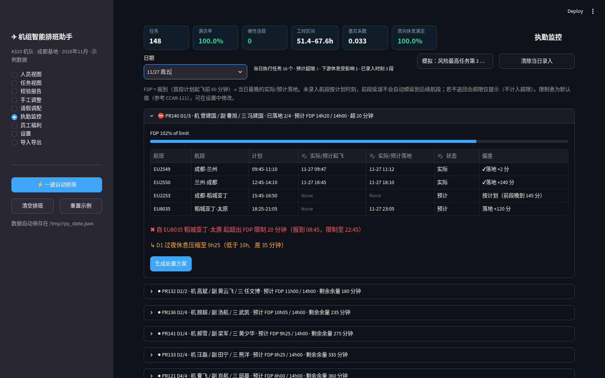
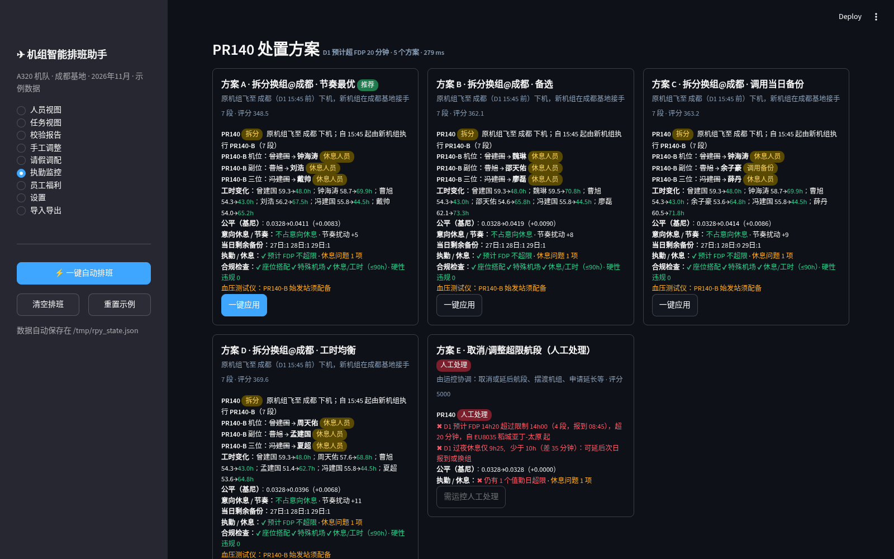
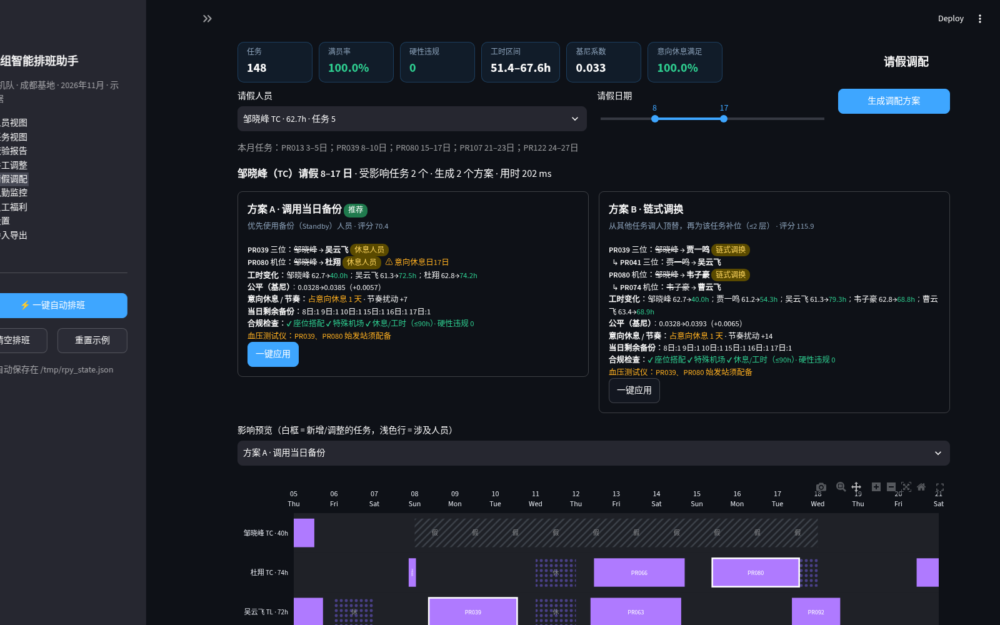
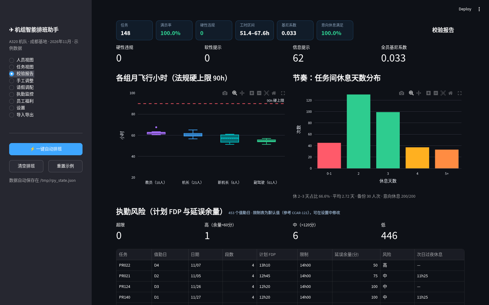
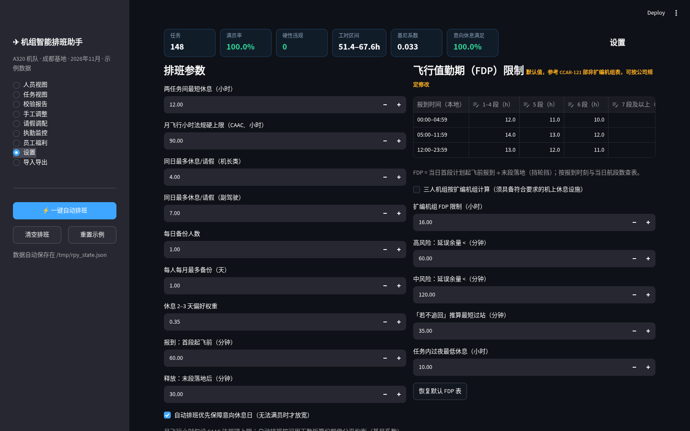
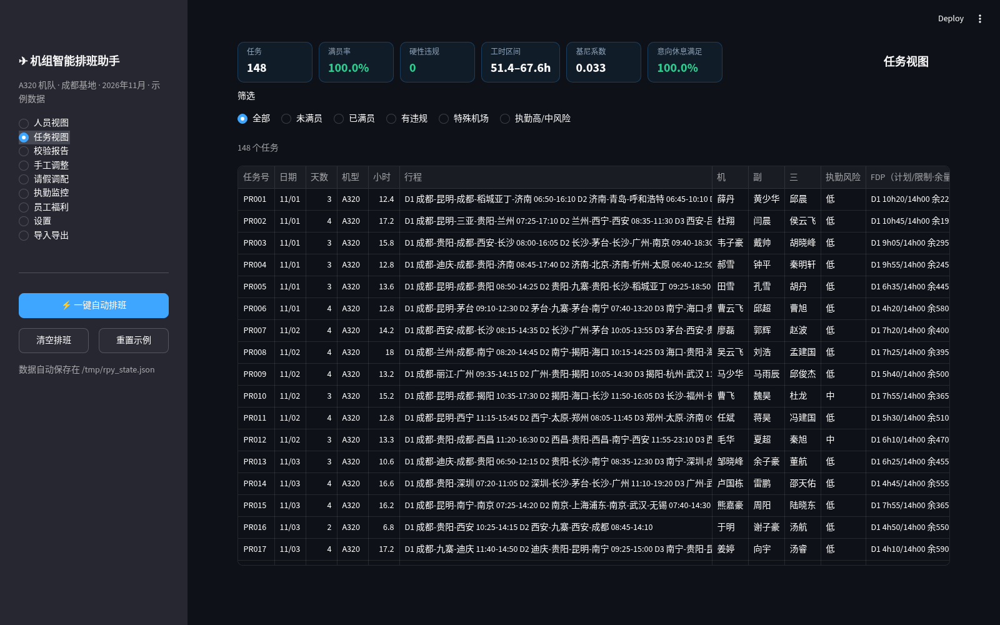
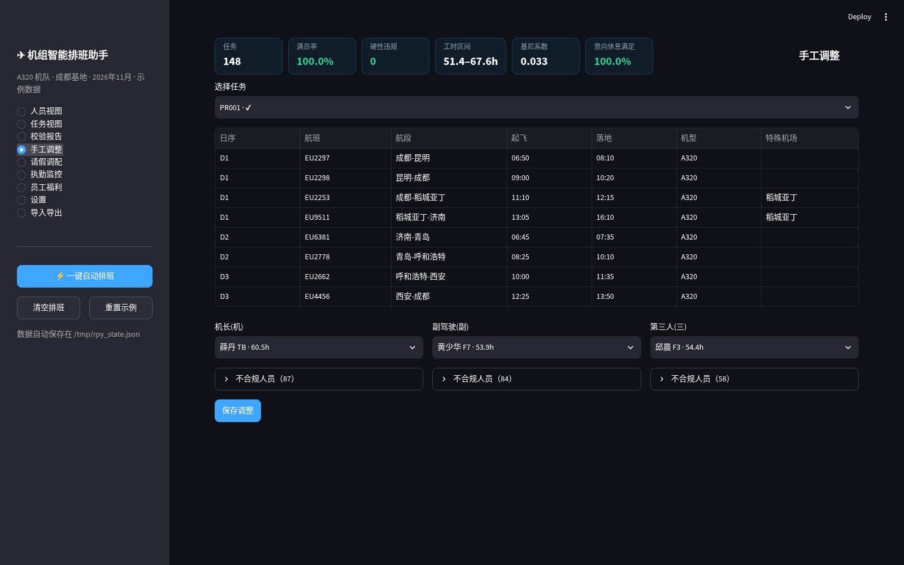
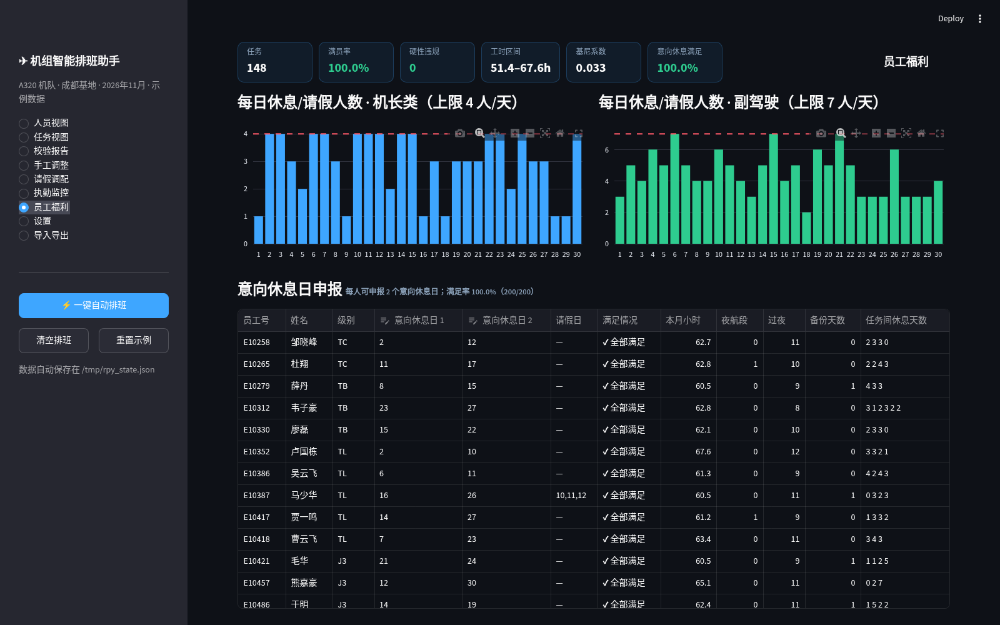
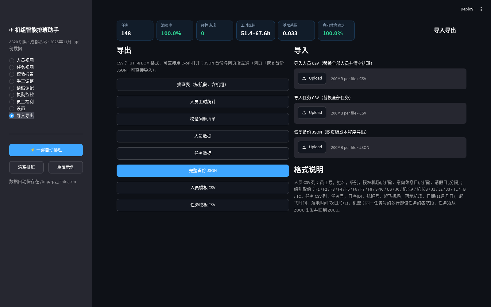
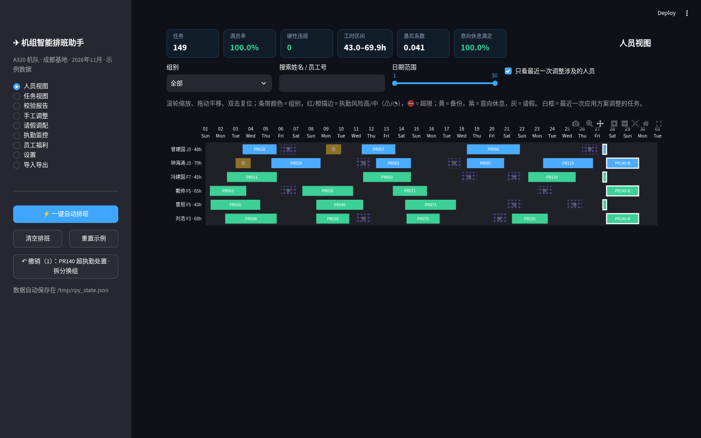

# ✈ 机组智能排班助手 · Python 版

[](https://jiqingan-web.github.io/crew-roster-demo/)
[](https://jiqingan-web.github.io/crew-roster-py/)
[](https://codespaces.new/jiqingan-web/crew-roster-py?quickstart=1)

A320 机队 · 成都基地 · 月度飞行机组排班：自动排班、合规校验、请假调配、执勤（FDP）监控与超执勤处置。
本仓库是网页版 [crew-roster-demo](https://github.com/jiqingan-web/crew-roster-demo)（[在线演示](https://jiqingan-web.github.io/crew-roster-demo/)）的 Python 重写：**纯标准库的排班引擎** + **Streamlit 中文界面** + **命令行**，与网页版同算法、同随机种子，结果逐项一致。

> Python 版需要在本机（或 Codespaces）运行；GitHub Pages 只能展示静态页面，无法运行 Python。想直接在浏览器里体验，请打开[网页版在线演示](https://jiqingan-web.github.io/crew-roster-demo/)。

## 截图

| 人员视图（甘特图，可缩放平移） | 执勤监控（按实际/预计时刻） |
|---|---|
|  |  |
| **超执勤处置方案** | **请假调配方案** |
|  |  |
| **校验报告** | **设置（FDP 限制表可修改）** |
|  |  |

<details><summary>更多截图</summary>







</details>

## 功能

- **自动排班**：贪心 + 局部改进 + 交换 + 置换链修复 + 意向休息修复 + 削峰 + 备份分配；满员 100%、硬性违规 0，工时按可用天数公平均衡（基尼系数约 0.033）。
- **规则**：RE12 巡航座位搭配、特殊机场授权与级别（拉萨 / 高原 / 赤峰 / 克拉玛依 / 茅台等）、A321 左座 J2+、新机长须教员同组、两任务间休息 ≥12h、CAAC 月度 90h 硬上限、血压测试仪始发机场提醒、FDP 限制表。
- **请假调配**：3–5 个方案（调用备份 / 节奏最优 / 工时均衡 / 链式调换 / 备选 / 人工兜底），影响指标、预览、一键应用与撤销。
- **执勤监控**：逐段录入实际/预计起飞落地（可跨午夜），预计 FDP、剩余余量、过夜休息、下游影响；「若不追回将超限」提示；拆分换组@成都等处置方案。
- **导入导出**：CSV（Excel 可直接打开）与 JSON 备份，**与网页版 JSON 互通**。

## 运行

### Mac

```bash
git clone https://github.com/jiqingan-web/crew-roster-py.git
cd crew-roster-py
python3 -m venv .venv
source .venv/bin/activate
pip install -r requirements.txt
streamlit run app.py          # 浏览器自动打开 http://localhost:8501
```

### Windows（PowerShell）

```powershell
git clone https://github.com/jiqingan-web/crew-roster-py.git
cd crew-roster-py
py -m venv .venv
.venv\Scripts\Activate.ps1      # 若提示禁止运行脚本：Set-ExecutionPolicy -Scope CurrentUser RemoteSigned
pip install -r requirements.txt
streamlit run app.py
```

也可以不装 git：在仓库页面点 **Code → Download ZIP**（或[直接下载](https://github.com/jiqingan-web/crew-roster-py/archive/refs/heads/main.zip)），解压后执行上面除 `git clone` 外的命令。
在 **GitHub Codespaces** 中打开（上方徽章）会自动安装依赖并启动界面。

- 需要 Python 3.9+（已在 3.13 测试）。首次打开载入示例数据（148 个任务 / 100 名飞行员），点左侧「⚡ 一键自动排班」约 4 秒完成。
- 数据自动保存在 `~/.roster_py/state.json`（Windows 为 `%USERPROFILE%\.roster_py\state.json`）；可用环境变量 `ROSTER_STATE` 指定。
- 运行测试：`pytest -q`（19 项，约 15 秒）。

## 目录结构

```
roster-py/
├── app.py                  Streamlit 界面（9 个视图）
├── roster/                 核心引擎（仅标准库）
│   ├── rules.py            常量、级别、RE12 座位搭配、特殊机场、A321、血压测试仪机场、休息、90h 上限、FDP 表与逐日 FDP
│   ├── generator.py        示例数据生成（mulberry32 随机数，与 JS 同种子 20261101）
│   ├── solver.py           自动排班：贪心 + 局部改进 + 交换 + 置换链修复 + 意向休息修复 + 削峰 + 备份分配
│   ├── metrics.py          校验（硬性/软性/提示）与指标（均值、标准差、基尼系数、节奏分布）
│   ├── leave.py            请假调配：单步与多方案（备份 / 节奏 / 工时 / 链式 / 备选 / 人工兜底）及方案评估
│   ├── fdp.py              执勤监控：计划风险、按实际/预计时刻滚动监控、下游休息、拆分换组、处置方案卡片
│   ├── history.py          撤销历史（请假与执勤处置共享）、一键应用方案
│   ├── io.py               JSON 备份（与网页版互通）、CSV 导入导出（UTF-8 BOM）
│   ├── models.py           数据结构说明（普通 dict，字段与网页版 JSON 相同）
│   ├── jsutil.py           与 JS 行为一致的取整 / 排序 / 拷贝工具
│   └── __main__.py         命令行 python -m roster
├── tests/                  pytest：test_core.py（对应 test/test.js）、test_io.py、test_parity.py、golden_js.json
├── tools/parity_dump.js|py 生成网页版 / Python 版对照数据
├── screenshots/            界面截图
├── docs/                   GitHub Pages 项目主页（静态介绍页）
├── .devcontainer/          Codespaces 配置
└── requirements.txt
```

## 界面（与网页版相同的视图）

| 视图 | 内容 |
|---|---|
| 人员视图 | plotly 甘特图：滚轮缩放、拖动平移、双击复位；组别配色，执勤风险 ⚠/◔/⛔ 描边，备份/意向休息/请假底纹；按组别、姓名、日期筛选；应用方案后白框高亮并可只看涉及人员 |
| 任务视图 | 任务表（行程、机组、执勤风险 / 每日计划 FDP 与余量、状态、血压测试仪），筛选：未满员 / 已满员 / 有违规 / 特殊机场 / 执勤高中风险 |
| 校验报告 | 指标卡、各组工时箱线图（90h 硬上限线）、节奏分布、执勤风险面板（超限/高/中/低、计划过夜休息偏短）、问题明细 |
| 手工调整 | 选任务 → 每个岗位只列合规候选（按本月小时升序，⚠ 占意向休息、备份标注），不合规人员逐人列出原因；保存前校验组合，可撤销 |
| 请假调配 | 选人员与日期 → 3–5 张方案卡（人员与任务前后、每人小时 ≤90h、基尼变化、意向休息、节奏、剩余备份、合规、血压测试仪），影响预览甘特，一键应用 / 撤销 |
| 执勤监控 | 逐段录入实际/预计起飞、落地（日期+时间，可跨午夜，预计/实际），FDP = 报到 → 最晚的实际/预计落地，不级联；「若不追回将超限」提示；过夜休息与下一任务休息；模拟按钮只改一段；生成处置方案（拆分换组@成都 / 整组替换 / 后续任务换人 / 人工兜底），一键应用，与请假共享撤销 |
| 员工福利 | 每日休息/请假人数（机长类 / 副驾驶，上限线）、意向休息日申报与修改（超上限拒绝）、每人小时/夜航/过夜/备份/休息间隔 |
| 设置 | 排班参数、90h 硬上限、FDP 限制表（默认值，参考 CCAR-121，可修改）、扩编机组、风险阈值、过站与过夜休息、血压测试仪机场、机场类别 |
| 导入导出 | 排班表 / 人员工时 / 校验问题 / 人员 / 任务 CSV，完整备份 JSON（网页版「恢复备份 JSON」可直接导入，反之亦然），模板，CSV/JSON 导入 |

**FDP 限制表（默认值，参考 CCAR-121 部非扩编机组表，可在设置中修改）**

| 报到时间 | 1–4 段 | 5 段 | 6 段 | 7 段及以上 |
|---|---|---|---|---|
| 00:00–04:59 | 12h | 11h | 10h | 9h |
| 05:00–11:59 | 14h | 13h | 12h | 11h |
| 12:00–23:59 | 13h | 12h | 11h | 10h |

## 命令行

```bash
python -m roster sample -o sample.json                         # 生成示例数据
python -m roster autofill sample.json -o filled.json           # 自动排班并打印指标
python -m roster report filled.json --csv out/                 # 校验报告 + 执勤风险，导出 5 个 CSV
python -m roster leave filled.json --pilot 毛华 --days 9-14     # 请假多方案；--apply 0 -o new.json 应用方案 A
python -m roster fdp filled.json --date 27 --pr PR140 \
  --leg "EU2550=16:45,18:10,act" --leg "EU8035=-,23:05"        # 录入实际/预计时刻（- 表示不填，+1 表示次日）→ 监控 + 处置方案
```

JSON 文件与网页版「导出 JSON」格式相同，可互相导入；旧版字段（testerAirports、minHours/maxHours、delays 延误分钟）读取时自动迁移。

## 与网页版对照

`tests/test_parity.py` 将 Python 结果与 `tests/golden_js.json`（由网页版 `js/core.js` 运行 `tools/parity_dump.js` 生成）逐项比较；
本机有 node 时可设 `ROSTER_APP=../roster-app` 现场重新生成。对照内容与结果（全部一致）：

| 项目 | 网页版 | Python 版 |
|---|---|---|
| 示例数据 | 100 人 / 148 任务 / 1895h，逐字段相同 | 相同 |
| 自动排班 | 满员 100%，硬性 0，软性 0，提示 62；148 个任务机组与 30 个备份日完全相同 | 相同 |
| 工时 | 51.4–67.6h，均值 56.84h，基尼 0.0328；意向休息 200/200；休 2–3 天 66.6% | 相同 |
| 请假（4 类人员 + 毛华 9–14 日 + 40h 兜底） | 方案名称、顺序、评分、变更签名、推荐项 | 相同 |
| 执勤风险 | 超限 0 / 高 1 / 中 6 / 低 446 | 相同 |
| PR140 场景 | 超 20 分钟，过夜 9h25；5 张卡：拆分换组@成都 · 节奏最优 348.5（推荐）/ 备选 362.1 / 调用当日备份 363.2 / 工时均衡 369.6 / 人工处理 | 相同 |

唯一差异是速度：自动排班网页版约 1.3 s，Python 约 4 s；请假方案约 40 ms vs 130 ms；执勤方案约 110 ms vs 270–400 ms。

## 示例场景（执勤监控）

11/27 PR140 D1（报到 08:45，限制 14h00 至 22:45）：录入 EU2550 兰州-成都实际 16:45 起飞 / 18:10 落地，再录入 EU8035 稻城亚丁-太原预计 23:05 落地 →
预计 FDP 14h20，超 20 分钟，过夜休息压缩至 9h25 → 推荐「拆分换组@成都 · 节奏最优」：自 15:45 成都起由钟海涛 / 刘浩 / 戴帅执行 PR140-B，超限 0、硬性违规 0
（若 EU8035 仍预计 23:05 落地，新机组过夜休息同样偏短，卡片会标出「休息问题 1 项」，需运控协调次日报到）。
